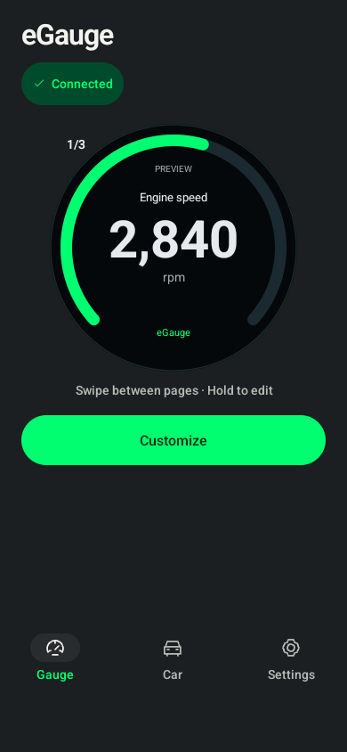
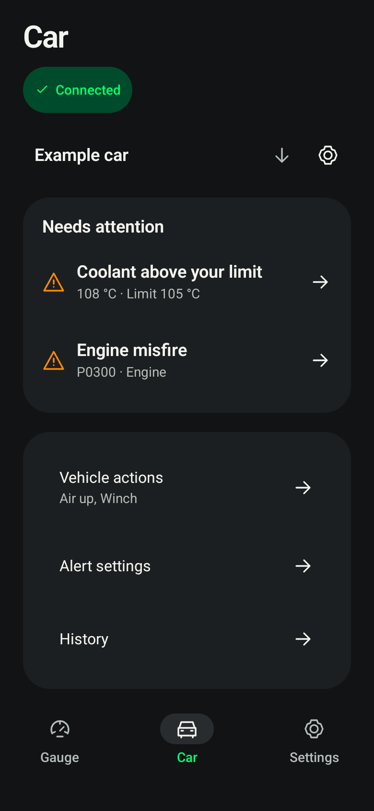
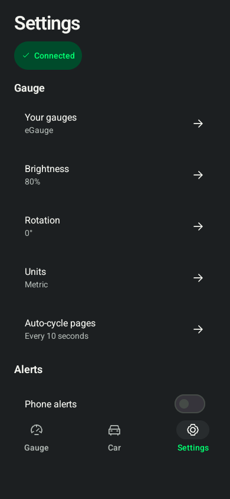
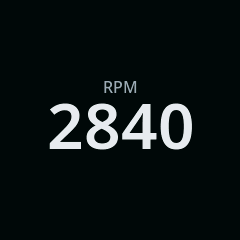
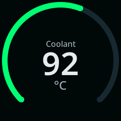
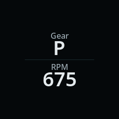
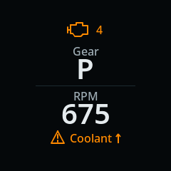

# eGauge

A standalone round OBD-II gauge with a native Android companion. Configure vehicle
readings, pages, alerts and display settings, then let the gauge run independently.
Owner-protected Bluetooth handles setup; authenticated private Wi-Fi carries signed
firmware updates. Normal use needs no account.

[Project website](https://egauge.majjix.com/) · [Website maintenance](website/README.md)

## Android App

| Gauge | Car | Settings |
| :---: | :---: | :---: |
|  |  |  |

## eGauge display

| Numeric | Arc | Dual | Alerts |
| :---: | :---: | :---: | :---: |
|  |  |  |  |

[Current support and installed-device evidence](docs/current-state.md) ·
[Roadmap](docs/roadmap.md) · [Backlog](docs/backlog.md)

## Try the development hardware

Current board: [Waveshare ESP32-S3-Touch-LCD-1.28](https://www.waveshare.com/esp32-s3-touch-lcd-1.28.htm),
240 × 240 touch display, ESP32-S3, 16 MB flash and 2 MB PSRAM. Use the touch model;
similar non-touch boards are not interchangeable.

An **unsupported experimental DIY option** is available: buy the board, bootstrap
current development firmware using [browser USB recovery](https://egauge.majjix.com/recovery/),
then sideload the Android APK linked there. Vehicle readings also require a compatible
BLE OBD-II adapter. This is not a production product or a blanket compatibility claim.
Existing paired gauges normally update through App/Wi-Fi.

Additional boards, displays and form factors are planned as hardware is evaluated.
[Contact us about custom needs](https://egauge.majjix.com/#custom-form).
Phone-only virtual gauges and possible Android Auto solutions are being investigated;
neither is available today. [Recovery maintenance and verification](web-recovery/README.md).

## Development

Clone this repository and enter its root. Prerequisites:

- Python 3.10+ with venv, Node.js/npm, a C11 compiler, CMake, Git and curl.
- JDK 17 and Android SDK: set `JAVA_HOME` and `ANDROID_HOME`, accept SDK licenses,
  then `sdkmanager "platform-tools" "platforms;android-36" "build-tools;36.0.0"`.
- [ESP-IDF 5.4.1](https://docs.espressif.com/projects/esp-idf/en/v5.4.1/esp32s3/get-started/):
  install its ESP32-S3 tools and source its `export.sh`. CI pins the same container digest.

```sh
python3 -m venv .venv
. .venv/bin/activate
python -m pip install -r tools/requirements-dev.txt
python tools/dev.py bootstrap                   # checksum-verified Kotlin formatter
python tools/dev.py lint
python tools/dev.py format --check
python tools/dev.py test
python tools/dev.py build
```

Lint, test and build support `--target host|firmware|android`; default is all. Use
`python tools/dev.py format` to apply formatting. Firmware checks require ESP-IDF
exported even while the repository venv is active; the launcher selects IDF's own Python. Android uses the checked-in wrapper,
resolved dependency locks and checksum verification. No command above accesses hardware.

Run isolated Android UI tests with `python tools/dev.py test --target android-ui`.
It downloads a disposable API 35 Pixel 2 image and needs hardware virtualization
(KVM on Linux, Apple Silicon or supported Intel acceleration on macOS). It never
installs on a connected phone. [More testing/capture details](docs/development/quality.md).

Build outputs: `android/app/build/outputs/apk/debug/app-debug.apk` and
`firmware/gauge/build/esp32-idf-project.bin`. An authorized debug APK installation uses
`adb -s SERIAL install -r PATH_TO_APK`. Firmware build output is not a signed release;
use the [release procedure](docs/development/firmware-release-runbook.md) for installation.

## Project guide

- [AGENTS.md](AGENTS.md): commands, conventions and do-not-touch boundaries.
- [Source map](docs/ai-context.md), [architecture](docs/architecture/system.md),
  [ADRs](docs/decisions/README.md), [protocols](docs/README.md#protocols).
- [Contributing](CONTRIBUTING.md), [setup details](docs/development/setup.md),
  [all documentation](docs/README.md).

| Folder | Responsibility |
| --- | --- |
| `firmware/gauge/` | Autonomous embedded runtime, display, adapters and protected updates |
| `android/` | Compose companion, local setup, presentation and serialized transport |
| `contracts/` | Versioned schemas, reading catalog and compatibility examples |
| `tools/` | Shared checks, generators and bounded capture/research utilities |
| `docs/`, `design/` | Maintained contracts/evidence and shared design tokens |
| `data/vehicle-definitions/` | Research archive; provenance/license review recorded separately |

## Licensing

Imported firmware retains its [MIT license](firmware/gauge/LICENSE); fonts retain
[SIL OFL](third_party/NotoSans-OFL.txt). See [third-party notices](THIRD_PARTY_NOTICES.md).
A project-wide license for new material has not been selected.
