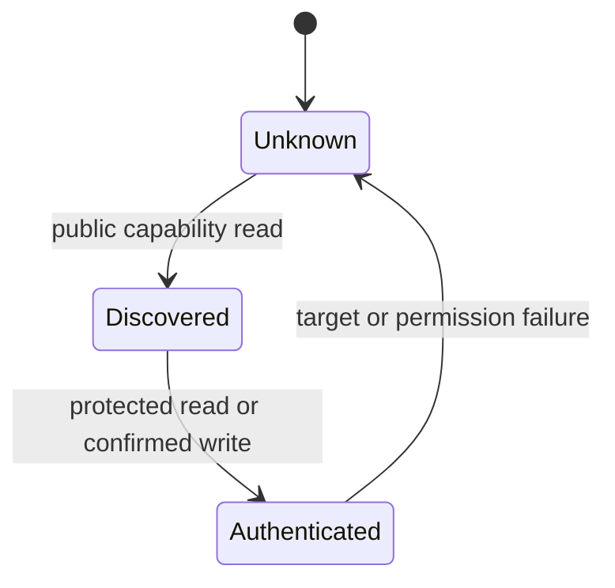
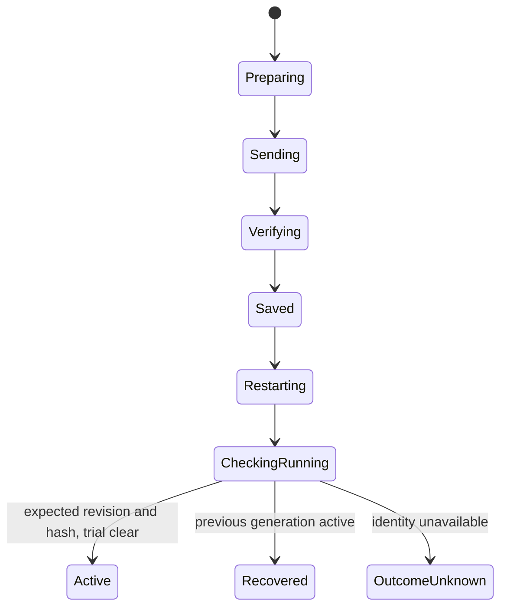

# Android companion runtime

Updated 2026-10-06. This describes current ownership; evidence limits are in [current state](../current-state.md).

## Responsibilities and boundaries

Gauge, Car and Settings are primary destinations; Settings reveals optional Expert.
Customize uses focused reading/layout sheets and exact review/send. Setup handles
association. Settings owns brightness, orientation, units, page cycling and updates.
Car owns source-specific fault views and adapter/profile selection. Technical reports,
definition examples and maintenance details remain in Expert. Preview readings never
become live vehicle observations.

`AppViewModel` owns operation lifetime. `MainActivity` owns Android permission prompts, the system file picker, and window flags. Composables only dispatch intent and render state. `OperationCoordinator` grants one process-local BLE operation lease, so discovery, protected reads, configuration, and firmware upload cannot overlap. Every terminal operation reports Active, Recovered, Failed, or Outcome unknown instead of relying on one generic progress string.

Public discovery and owner access are separate states:

Discovery gathers all matching advertisers for a short bounded window. A single result is selected automatically. Multiple results require a user choice. Multiple identities and per-gauge desired vehicle/source assignments are remembered locally; the phone selects one connection at a time. Settings owns the saved-gauge picker. RSSI orders the list but never proves identity. Android owns the bond secret; the app stores no passkey or bond key.

## Configuration transaction

`ConfigurationProjector.projectVehicle` sends one whole vehicle dashboard through
its primary adapter. Explicit Expert child mode changes transmission-definition
routing to a second adapter; it never filters pages. New execution requires `va:1`,
and two transports also require `da:1`. The editor, review and wire payload retain
the same page order and actions. Per-source reads, retry schedules and confirmed
revision scope stay separate. Source selection edits only an Expert binding.
The transaction captures profile, dashboard, base revision and base hash before sending.

Stored revision and hash alone do not establish success. `GaugeConfigTransferClient` waits for runtime identity, rejects mismatches, keeps a trial in Waiting, and exposes firmware recovery. Cancellation closes the GATT connection and does not convert cancellation into a retry failure.

## Evidence lifetime

Device-specific caches are cleared when discovery fails or a different target is selected. Owner state becomes authenticated only after a protected operation succeeds. Diagnostic freshness is derived from a monotonic receipt timestamp and expires after 30 seconds. Vehicle PID examples never become vehicle observations. An observation model carries profile, session, adapter, ECU, source, PID, and observation time.

## Storage and recovery

Profile schema 19 reads schemas 1 through 19 and requires coupled vehicle and gauge
assignment storage. Schema 19 adds phone-only alert enablement; older profiles default
all rules enabled. Disabled drafts retain limits/timing but are excluded from wire
definitions, capability gates and setup comparisons. A gauge restore retains compatible
disabled phone drafts. Older Apps reject schema 19 rather than re-enabling them.
`LocalSetupStore` saves both documents in one `profiles-v1`
preference commit. The old association file is a read-only migration input. Older
Apps reject newer profile schemas rather than loading stale assignments. Unknown schemas and
invalid documents fail closed without replacing the source. Standalone TCM profiles
remain separate until explicitly attached; that attachment moves their assignments
in the same commit. See [vehicle connections](vehicle-connections.md).

`LocalSetupTransactions` loads, transforms and commits the whole setup through
`DurableWrites`, one mutex and the IO dispatcher. UI state changes only after the
commit succeeds. Queued cancellation does not start a write; an admitted platform
commit finishes before its lease is released. On commit failure, the prior memory
map is restored best-effort, the visible model is retained and setup edits stop
until reopening/review. A second failed rollback cannot guarantee disk recovery.
Page browsing changes an ephemeral cursor without a disk write.

`GaugeModels.kt` owns domain models. `PairingFailure`/`OwnerReadFailure` distinguish
pairing reasons from retryable protected reads. `suspendResult` preserves coroutine
cancellation and fatal errors; only cleanup uses bounded noncancellable work.
`AppViewModel` still owns lifecycle and transport outcomes. A local mutation uses
the same operation lease and waits for automatic read cleanup.

`FirmwareUpdatePersistence` owns the separate update journal and per-gauge hold.
Candidate identity is durable before upload starts. Verified device success remains
success if phone cleanup fails; the journal stays available for recovery. Corrupt
journals become uncertain records requiring authenticated healthy running readback,
never silently disappear. An image without confirmed OTA health does not clear
uncertain recovery evidence. BLE upload remains an explicit foreground workflow.
See [offline hardening](../evidence/offline-hardening.md) for evidence and limits.

## Protocol and transport rules

Protected status reads may receive ATT `0x11` while a firmware worker owns a
zero-wait snapshot lock. Retry that read at most four times, with 100/200/300 ms
delays; never replay the preceding write. The existing owner-establishment budget
also accepts this transient status. Other GATT errors, authentication requirements,
disconnects and coroutine cancellation keep their existing handling.

Pure codecs validate capability JSON, diagnostics, and runtime identity before UI state changes. Invalid versions, lengths, reserved bits, and ranges are errors. Transfer callbacks enter a bounded channel. The process-level operation coordinator serializes sessions, and each client connection owns its callback queue and deadline. A callback cannot complete another connection's deferred result.

Production support still requires a shared reusable GATT request layer if the protocol surface grows. The current bounded and serialized behavior is the compatibility-preserving foundation. `WifiBulkClient` implements the authenticated private Wi-Fi update path using the
same protected maintenance state. Configuration remains on the bounded BLE path.

## Feature evidence boundaries

[Current state](../current-state.md) owns installed and observed support. The current
runtime has independent workers behind optional child routing; source-level support
never establishes simultaneous-radio qualification. Phone previews remain examples.
Controller writes, diagnostic clearing and production capabilities remain gated.

## Regional units

On first use, `preferredMeasurementSystem` uses the Android app locale region and
Unicode temperature preferences. US, Bahamas, Belize, Cayman Islands, Puerto Rico
and Palau default to Fahrenheit; other regions default to Celsius. A saved choice
wins. Confirmed gauge settings remain authoritative and do not get overwritten by
regional defaults. No language-only inference or automatic gauge write is made.
The existing Metric/Imperial preference also controls speed presentation; canonical
configuration and alert values stay metric. Region mapping follows
[Unicode CLDR measurementData](https://raw.githubusercontent.com/unicode-org/cldr/main/common/supplemental/supplementalData.xml).

## Confirmation after gauge restart

A protected reconnect attempt's own timeout is retryable read unavailability, not
cancellation of the user's transaction. `restartRead` distinguishes session timeout
from actual caller cancellation and closes each attempt before the next. Configuration
confirmation shares a bounded saved/running read budget; firmware uses its existing
exact-image and trial decision deadline. Never resend an uncertain write to obtain
confirmation. Evidence: [restart/editor rollout](../evidence/restart-and-dashboard-rollout.md).

Schema 13 adds exact controller-scoped CEL filters to the primary vehicle draft. Missing rules default to empty; validation preserves malformed/newer source documents. Filters persist with existing coupled setup transactions and restore from gauge configuration readback. [Shared policy](alerts-and-diagnostics.md#advanced-vehicle-scoped-cel-code-filters) owns their presentation and notification behavior.

### Phone-only idle presets

Schema 14 adds up to two validated Air up/Winch preset drafts to the parent vehicle.
Older schemas load with no presets; unknown IDs, fractional numbers, duplicate IDs
and out-of-envelope drafts reject the document rather than replacing it. Children
cannot store their own idle presets. Existing coupled setup commits own persistence.
Preset drafts survive dashboard splitting and explicit gauge-setup restoration.
Numeric target drafts stay excluded from gauge bytes. Schema 15 adds the typed
vehicle-actions gesture destination to parent profiles. When that menu is assigned,
its two duration fields are part of the normal configuration and exact comparison;
changing a duration therefore makes that menu configuration unsent until applied.
Children cannot own the menu. Older Apps reject newer profile schemas; downgrade
needs a compatible backup/migration. Command ownership and qualification are defined in
[vehicle actions](vehicle-actions.md#shared-command-owner).

Schema 16 adds optional `airUp` calibration and pressure inputs inside the parent's
Air up preset. Existing fixed timers migrate without invented pressure values.
Strict validation binds the stored effective seconds to the estimate or explicit
override; children/Winch cannot own this record. Older Apps reject schema 16 rather
than silently dropping calibration. [Four-tire timer policy](vehicle-actions.md#four-tire-air-up-timer)
owns calculation, limits and evidence boundaries.
