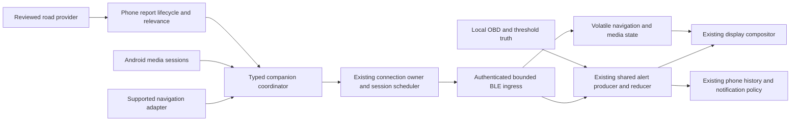

# ADR-016: Phone companion content integration

**Status: Architecture approved; initial experimental slice implemented.**
Prepared 2026-10-18; owner approved the plan and reusable-session/synthetic-test
slice on 2026-10-19, with an explicit removable-experiment requirement. Decider:
product owner. Live adapters, broader streaming and device/release gates remain.
[Backlog](../backlog.md) owns FEATURE-02/FEATURE-06 readiness and priority.

The [experiment runbook](../development/companion-session-experiment.md) describes
the bounded session extraction, explicitly invoked synthetic road probe and removal
steps. The owner permits its marked package in debug/release APKs; it is inactive
without a future explicit developer entry point, with no special build variant.
The normal App retains one-shot sessions. Background reuse/preemption and the
proposed typed content wire/state are not implemented by this initial slice.

## Recommendation and product scope

Add a small typed companion-content boundary to the existing Android App and
authenticated gauge connection. Reuse the shared alert framework for road hazards;
use replaceable, expiring state for navigation and now-playing information.
Keep source acquisition, location, relevance, attribution and speech on the phone.
The gauge receives bounded display-ready facts and remains an autonomous instrument.

Owner choices for this proposal:

- Keep **Google Maps/Waze** as the navigation app. Building navigation inside eGauge
  is outside the selected scope. Live maneuver acquisition remains an explicit
  feasibility gate, not an assumed feature of notification access.
- Music starts with **track information only**. Playback commands, volume, album
  artwork, audio streaming and changes to existing gestures are outside this slice.
- Android and the current ESP32 hardware are the target. iOS remains deferred.

The first useful delivery is a synthetic end-to-end content slice, followed by a
reviewed road-alert pilot. Navigation/media adapters can follow independently;
neither is required for vehicle setup, local alerts or ordinary gauge operation.

## Findings and their limits

### Existing eGauge seams, verified against source

| Existing owner | Reuse | Gap this proposal addresses |
| --- | --- | --- |
| `ExternalAlerts.kt` | Typed `PhoneAlertProvider`, reviewed-provider validation, synthetic fixture | Only synthetic review is registered; no live acquisition, slot allocator or source scheduler |
| ADR-015 / `alert_runtime.c` | Severity, episodes, attention, local expiry, history and context | Navigation/media are state, not alert episodes; distance refresh must not create history spam |
| Protected `3E` / `3C` | Eight external slots, 31-byte title, 11-byte context, boot/sequence protection and readback | No structured maneuver/media fields or delivery-scope token; do not overload title strings as a second protocol |
| `GaugeConfigTransferClient.withGauge` | Authenticated owner establishment, serialized ATT work and bounded GATT cleanup | Each call currently connects and closes; unsuitable for a one-second navigation stream |
| `OperationCoordinator` / AppViewModel | One operation owner, user-operation exclusivity and scoped read recovery | Need a bounded session scheduler that can reuse the same connection without holding the operation mutex for an entire drive |
| `AlertMonitoringService` | Application-scoped owner and connected-device foreground service | It is currently tied to phone alert monitoring; content-only operation needs an independent demand model |
| `ui.c` / `gauge_layout.c` | One LVGL owner, fixed templates, MIL above and condition below readings | Add one bounded companion snapshot and explicit arbitration; no provider-specific widgets |
| `worker_health` / `memory_health` | Existing progress, drop and memory evidence | Add companion rejection/expiry/replacement counters within these owners |

The current App has no notification listener and no modern foreground-location
service declaration. Its legacy location permissions stop at API 32. Starting a
live road provider therefore requires an explicit Android permission/lifecycle
change, not just connecting the existing provider interface. The former synthetic
Expert button has been removed; the fixture/codec seam remains.

### WzSabrePOC findings worth carrying over

Reviewed the sibling `WzSabrePOC` source, README, Phase 9 results and October 18
drive review. This directory has no Git metadata at review time; reproducibility
uses the source fingerprints below, not an invented commit/version guarantee.

| Finding | Integration consequence | Evidence limit |
| --- | --- | --- |
| Read-only SABRE adapter, request IDs, complete multipart responses and generation fencing | Port these small policies and tests behind a provider adapter | Legacy broadcast callbacks are not cryptographically authenticated; random actions are correlation, not sender authentication |
| Fresh network recovery requires a new complete response; local monotonic freshness and expiry | Reconnect must not promote cached reports to fresh | A complete plugin response does not prove a new upstream observation |
| Recorded request latency about 31 seconds and complete-response cadence about 61 seconds | Show useful remaining freshness; BLE speed cannot fix source latency; benchmark before shortening polling | Historical recording, not a guaranteed cadence |
| Plugin report/confirmation timestamps have uncertain provenance | Preserve plugin-supplied age, receive age and uncertainty separately; confirmations never rejuvenate a report | Receive time cannot reconstruct missing upstream provenance |
| Independent location, relevance, recorder and generation-tagged road work | Move reusable pure policies, not the prototype Activity/service/storage wholesale | Existing POC architecture review also identifies unfinished report-lifecycle work |
| Limited moving capture and sustained screen-off retrieval were recorded | Carry forward lifecycle tests and preserve independent freshness | This does not qualify on-road relevance or all Android power states |
| Road matcher had no definitive on-path cases in that capture; two conservative uncertainty retentions in replay | Keep road matching in shadow/comparison mode until a labelled drive validates it; missing coverage is unknown, not irrelevant | Replay scores do not establish real-drive precision/recall |
| Phase 9 speech eligibility, distinct-fix persistence, duplicate suppression and bounded speech | Reuse the policy later through one phone attention owner; do not automatically enable speech in eGauge | Live moving announcement timing and in-car audibility remain unqualified |

The October 18 review records 2,315 frames, 39 new complete responses and an
approximately 8-minute-21-second continuous dark/locked interval. Only about
174 seconds met its moving-speed threshold; the recording hit its former 25 MiB
cap and lacks an end marker. Later recorder changes are described in Phase 9.
Those are local recorded findings, not a new independent replay or physical test
performed for this proposal. No private route or reporter data is copied here.

Useful source units are `SabreClient.java`, `BatchAccumulator.java`,
`RecoveryPolicy.java`, `CourseTracker.java`, `RelevanceEngine.java` and their tests.
Review cumulative byte/record limits before reuse: the prototype accumulator can
hold up to 64 batches of 1,000 records. Its main-thread JSON parsing and prototype
retention choices are not the target production design. Keep map graphs, raw
plugin JSON and experiment recordings off the ESP32. Never import decompiled
third-party sources, bundled credentials or captured private payloads.

### Source feasibility is separate from the interface

| Content | Preferred acquisition | Decision/gate |
| --- | --- | --- |
| Road reports | Reviewed read-only provider adapter; SABRE is the measured POC candidate | SABRE documents inter-app broadcasts, not rights to its upstream feed. Keep a WzSabre pilot opt-in and experimental until access, attribution, upstream terms and callback trust are reviewed. No private upstream endpoint reimplementation. [SABRE](https://sabre.app/tech) |
| Google Maps/Waze maneuvers | Supported structured integration with the chosen consumer navigation app | No qualifying direct maneuver feed was established in this review. Navigation Connect documents enterprise trip/location/ETA/route telemetry and a backend, not a demonstrated next-turn stream for this product. Treat it as a separate evaluated option, not proof the requirement is solved. [Navigation Connect](https://developers.google.com/maps/documentation/navigation/connect/overview) |
| Navigation SDK feed | Structured maneuver/distance data from navigation owned by our application | Technically relevant to small displays, but embedding navigation conflicts with the owner's current Maps/Waze choice. Retain as an alternative only if that choice changes, with terms/cost review. [SDK turn feed](https://developers.google.com/maps/documentation/navigation/android-sdk/tbt-feed) |
| Now playing | Android `MediaSessionManager` and `MediaController` callbacks, source package selection and read-only metadata | Other apps' active sessions normally require enabled notification-listener access or privileged media permission. Request consent only for music; read media sessions, not arbitrary notification text. Compatibility and metadata completeness still require testing. [Android API](https://developer.android.com/reference/android/media/session/MediaSessionManager) |

The prior Maps-notification experiment produced instruction text and arrival
estimates but no reliable decoded direction/distance; removal/reposting did not
reliably mean route completion. It was explicitly removed. Do not revive it as
the production navigation source, use OCR/accessibility scraping, or infer a turn
arrow from free text. The stable interface can be implemented and tested while
live Maps/Waze directions remain unavailable. A future experimental text preview
would require a separate explicit scope decision and could not claim turn guidance.

## Options considered

| Option | Strength | Cost/risk | Decision |
| --- | --- | --- | --- |
| Copy the POC screens/service into eGauge | Fastest apparent demo | Duplicate session/location/alert owners, permissions, storage and recovery; source assumptions leak throughout App | Reject |
| Keep POC installed and relay broadcasts between both apps | Isolates experiments | Two foreground lifecycles, version/trust matrix, install dependency and extra failure boundary | Keep POC separate as a research lab; no production dependency |
| Small typed boundary inside eGauge, source adapters isolated in packages | Reuses owners and tests; one installation; providers can fail independently | A focused reusable GATT-session extraction and new wire/state handling are necessary | Recommend |
| Cloud aggregation and continuous gauge Wi-Fi | Central provider abstraction | Network/backend dependency, privacy, expense and radio/memory pressure | Defer; an authorized provider may use cloud internally without changing gauge contract |

Avoid a generic plugin bus, message broker, new database or broad AppModel rewrite.
Start with ordinary Kotlin packages/interfaces and C modules; extract a reusable
library only when both products genuinely need the same versioned code. Preserve
POC experiments and fixtures independently until integration passes acceptance.

## Proposed ownership

One application-scoped `CompanionContentCoordinator` combines source state,
active vehicle/gauge assignment, user preferences and delivery availability. It
emits immutable projections. Provider workers never obtain a BLE lease, choose
firmware commands, manipulate UI widgets or write ECU state.

Keep the App's current one-active-gauge policy. Bind delivery to that gauge's saved
vehicle assignment; never broadcast phone content to every remembered gauge.
Simultaneous delivery to several gauges requires a separate resource/UX review.

Proposed packages: `companion/` for models/coordinator/projection, with
`companion/providers/road`, `navigation`, `media` adapters. Keep road geometry in
pure phone-side classes. The owning model delegates to these boundaries and keeps
existing operations intact. UI observes the existing shared state/status surface.

On firmware add `companion_content.c/.h` for bounded validation/state only, ticked
by `app_tick`, and one UI snapshot consumed by the LVGL owner. Road events adapt
into `alert_runtime`, retaining the existing eight-slot limit. Reuse existing
memory/progress reporting. No new task, BLE connection, event database, watchdog
or dynamic provider registry is needed on the gauge.

### Different data, shared delivery

| Type | Payload and identity | Lifetime/history |
| --- | --- | --- |
| `RoadNotice` | Provider + source report ID, reviewed category/severity, short label, relevance/distance basis, availability and attribution reference | Shared ADR-015 episode, attention and context. Coalesce repeated observations. Changes in displayed distance are volatile metadata, not new history transitions |
| `NavigationState` | Provider/route session/step generation, maneuver enum, optional roundabout exit, distance in canonical meters, compact road label; active/rerouting/arrived/stopped | One latest state, locally expiring; never a CEL, alert episode or notification-history item |
| `MediaState` | Provider/media session/track generation, title, artist and playing/paused/stopped | One latest state; no track history or repeated phone notifications by default |

Each uses a common envelope: schema version, content kind, target binding/session,
producer generation, sequence, source availability, simulated flag and conservative
validity deadline. The binding covers vehicle, gauge, running config revision and
gauge boot. Human labels are not identities. Keep full IDs/context on the phone;
the wire can use session-scoped compact IDs with collision-checked allocation.

Do not give arbitrary third-party text severity, executable actions, URIs, arbitrary
icons or layout instructions. Unknown content kinds/versions are rejected cleanly;
optional fields are ignored only when the negotiated schema permits that behavior.

## Protected protocol and delivery plan

Define one proposed `Companion Content v1` contract before allocating opcodes.
Final bytes belong in `docs/protocol/` with production Kotlin/C parity vectors;
this ADR does not change existing opcodes, public flags or settings schema.

1. **Negotiate after owner authentication.** Read typed schema/kind/length/rate
   capabilities through a bounded protected response. Older firmware returns
   unsupported; ordinary OBD/settings/update behavior remains available. Avoid
   growing the already bounded public capability JSON as a shortcut.
2. **Open a scoped session.** Gauge validates boot/config and returns a fresh
   session token and applied-state cursor. Provider/vehicle/gauge/owner changes
   retire the session. The worker checks scope again immediately before apply.
3. **Replace state or update a road episode.** Sequence is per session/stream;
   route/track generations prevent late data from replacing newer content. Same
   sequence and same payload is idempotent, with no TTL renewal. Same sequence
   with different bytes, retired token or old generation is rejected.
4. **Confirm application.** ATT success means admission only. A compact applied
   status reports session, per-stream applied sequence, expiry and typed rejection.
   Coalesce routine confirmation; do not read full alert history on each update.
   Status never claims that the driver saw the content.
5. **Expire, clear, close.** Explicit source end/disable sends a newer clear.
   If delivery is impossible, local deadlines clear the gauge. Link loss alone
   cannot extend content. Reconnect gets a new token and fresh producer state;
   stale backlog is discarded rather than replayed.

Keep existing `3E`/`3C` compatible for current tests. The new road ingress calls the
same validated alert producer behind a scope-aware worker boundary; do not encode
navigation/media in `3E` labels or add parallel alert storage. The current `3E`
frame carries a boot ID but no config revision/session token, so it is not the
complete new session-scoping contract. Complete the bounded slot allocator before
real multiple-road delivery: same report retains its slot; withdraw and confirm
before reassigning an occupied slot; ambiguous outcomes require readback. Reserve
monotonic sequence blocks durably if needed, rather than writing preferences on
every navigation update. Gauge content itself remains RAM-only.

**Framing:** target a maximum 160-byte normalized content message, inclusive of
its envelope. Existing owner ingress permits at most 173 bytes, but negotiated
ATT MTU can be 23. Never assume one content message fits one ATT write. Specify
one bounded reassembly slot, maximum fragment count, total length, assembly
deadline, session/sequence identity and atomic publication only after all fragments
validate. New generations cannot inherit partial data. Compare explicit fragment
commands with the existing reliable-long-write behavior in a small transport test;
choose one measured path and document it. No extra GATT service unless actual
measurement proves the existing owner characteristics unsuitable.

**Clock handling:** phone and gauge monotonic clocks are not interchangeable.
At session open, estimate an offset interval from a bounded round-trip sample;
translate the phone deadline to the earliest safe gauge expiry. Include uncertainty
and resample before the mapping ages out. Reject time-sensitive content when the
bound is unusable. Subtract queue/assembly delay, reject future/impossible source
ages, and use wrap-safe gauge arithmetic with lifetimes below half the clock range.
A heartbeat proves the bridge is alive, not that provider content is fresh.

### Reusable session without a new BLE owner

Extract the existing protected connection/discovery/authentication/ATT/cleanup
mechanics into a small internal `GaugeOwnerSession`. Keep `withGauge` as its
one-shot adapter so configuration, update and current reads retain their contracts.
Validate that extraction independently before enabling a long-lived session.

The existing owner/coordinator admits logical operations; one transport scheduler
serializes ATT work and can reuse the active session between those operations.
Do not hold the current operation mutex for a whole driving session. Background
content uses short bounded turns, coalesces by stream, and yields between messages.
No second GATT connection is opened for alerts, content or the Activity.

User configuration, discovery, diagnostics clearing and OTA preempt content. Drain
or cancel one bounded in-flight transaction and await cleanup before handing over.
Maintenance invalidates content and closes the session; Wi-Fi remains temporary
maintenance transport. Normal polling can share the session in scheduled turns;
content cannot starve settings, fault history, owner checks or critical user actions.
Disconnect, database change or cancellation retires all callbacks before reuse.

Retain current one-shot behavior as the rollback path with content disabled.
Transport adoption requires regression evidence, not a wholesale migration of every
client method. A connection/authentication failure uses the established read-recovery
policy and jittered backoff; it never silently repairs bonds or rewrites ownership.

## Initial budgets and recovery rules

These are **proposed ceilings/acceptance targets**, not measured capabilities.
Reduce content rate or scope when loaded testing fails; do not reduce OBD freshness
or increase Wi-Fi buffers to make companion content fit.

| Resource | Initial bound |
| --- | --- |
| Phone delivery pending state | Latest navigation, latest media, at most eight road identities plus reserved clear/session control; replacement counters visible in Expert |
| Source decode | Off-main worker; at most one road request; cumulative 1 MiB decoded input and 2,000 records per accepted response initially; oversized/incomplete response fails atomically, never presents silent truncation as complete |
| BLE content | At most four messages/second and 640 normalized bytes/second; control/readback/framing overhead measured separately; fair service still required under load |
| Navigation | At most two updates/second, normally one; four-second validity, refreshed only from valid current adapter state; no phone-derived made-up distance countdown |
| Media | Change driven; at most one update/second, revalidate current session about every ten seconds; 30-second validity; stop/removal/revocation clears promptly |
| Road display lease | At most 15 seconds, renewed about every five seconds only while source/location/relevance are valid; clamp to remaining source, location, report and reviewed-provider lifetimes, never above the existing ten-minute provider cap |
| Initial freshness policy | POC source gate 90 seconds after complete response; direction gate ten seconds with valid course/accuracy; distinguish report age from source age; tune only with recorded evidence |
| New firmware memory | Target at most 4 KiB additional internal RAM and 8 KiB bounded PSRAM/LVGL allocation combined; one reassembly slot, no new task/stack, no album art, heap allocation or NVS writes per update |
| Connected delivery | Target p95 phone-normalized-state to gauge-applied state within one second; local expiry within one 100 ms application tick of deadline |
| Loaded behavior | No new allocation failures, queue leaks or loss of existing health margins; no greater than 10% degradation in p95 existing OBD sample age against the same single/dual-load baseline; retain existing hard stale deadlines |

The firmware budget includes new static state, queues, reassembly, metadata and UI
widgets, not only payload arrays. Compare linked internal usage, LVGL heap, internal
minimum/largest block and every task's stack with baseline, including subsequent
full Wi-Fi upload. The current bench minimum/largest block is evidence, not spare
RAM promised to this feature. Failure to allocate optional UI/state disables content
cleanly; local gauge functions continue. Existing alert slots are not multiplied.

| Failure | Required behavior |
| --- | --- |
| Provider/network loss, partial response or source timeout | Mark source unconfirmed; stop renewals; expire gauge content; bounded reads retry with jitter. Restoration requires a fresh complete response |
| GPS stale/uncertain, stationary heading or graph coverage missing | Suppress confident-ahead/speech claims; do not silently infer same-road relevance. Road matching stays shadow-only until qualified |
| Phone screen off/locked | The admitted foreground session continues without the Activity; source freshness still requires real progress and delivery never depends on an unlocked screen |
| Phone killed/rebooted | Already delivered content expires independently. Recreate current state only when Android permits; explicit Force stop/Stop is respected |
| Bluetooth off/out of range, gauge reboot | Local vehicle operation continues; retire stream session/slot mapping; verify new boot/config before sending current state |
| Saturation or rapid track/step churn | Latest state wins; priority controls and clears have reserved admission; record replaced/rejected counts. No unbounded FIFO or stale scrolling backlog |
| Active vehicle/gauge/config change | Invalidate before publication and again at apply. Clear prior surface or await its fixed expiry; never retarget queued content to the new vehicle |
| Permission revoked, source app removed or user disables a type | Stop that adapter, close callbacks/location leases and clear its content; other types/local vehicle alerts continue |
| OTA/configuration begins | Content yields automatically, valid state expires, maintenance uses existing transfer gate. No automatic replay after update |
| Flash/storage full on phone | Current vehicle truth and RAM content continue; existing history reports storage failure truthfully. No new automatic raw trip recorder |

## Android lifecycle, consent and storage

Use one application-scoped service lifecycle with explicit demand from existing
alert monitoring and each enabled content type. Stopping road reports must not
disable existing vehicle notifications or music; stopping music must not stop
location needed by an opted-in road session. Initially start a road driving session
from a visible user action; retain the persistent quiet service notification and
Stop action. Do not promise automatic restart from Force stop or reboot.
Do not copy the POC's recurring wake lock by default; add a short renewable lease
only if measured work requires it, with release on Stop/failure and explicit power
evidence. A foreground service does not guarantee unlimited background execution.

Select `connectedDevice` and, only while using location, `location` foreground
service types/permissions according to Android rules. A connected-device service
does not grant location access. Request modern foreground location only at road
opt-in, support denial/approximate location as reduced availability, and stop unused
location subscriptions. Do not add background-location or battery-exemption prompts
by default. Companion-device association/presence can be evaluated later without
changing bond/owner semantics. [Service types](https://developer.android.com/develop/background-work/services/fgs/service-types),
[background BLE](https://developer.android.com/develop/connectivity/bluetooth/ble/background).

For media, request notification-listener access with a clear explanation of its
broad OS scope; only retain selected packages' media-session metadata. Do not
persist or forward messages, calls, raw notifications, session tokens or artwork.
Detach controllers when sessions change or access is revoked. Do not declare a
media-playback foreground service solely to observe someone else's playback.

Persist only feature choices, provider selection, per-gauge/vehicle presentation
preferences and bounded identity/deduplication metadata through existing durable
owners. History/context reuses ADR-015 and its retention/export rules. Do not store
navigation steps or music listening history in alert history. Exact-location
experiments remain explicit, separate private captures with retention/consent;
source requests can still disclose location to an upstream app even if eGauge
does not store it. No credentials, trip data or real report payloads enter fixtures.

## Gauge and App UX

Apply the existing [circular display rules](../design/gauge-ui-proposal.md#1-circular-layout-and-typography-contract).
Keep CEL/MIL at the top, primary readings in the center and one concise condition
surface below. No overlapping independent banners, engineering text, duplicated
units, scrolling warnings or provider-controlled layouts.

Presentation order:

1. Pairing/security/maintenance surfaces retain existing exclusive behavior.
2. Existing local Warning/Critical attention and MIL semantics retain precedence;
   media/navigation cannot acknowledge, obscure or suppress them.
3. Reviewed road notices enter existing alert arbitration. Critical is forbidden
   to external providers. Initial road notices are Advisory, with no takeover.
4. When the bottom condition lane is free, navigation can use one compact arrow +
   distance row; the road label/full guidance belongs on an optional companion page.
5. Music is on an optional companion page, off by default. No automatic track-change
   takeover in the first slice. Manual selection never replaces the saved OBD page.

A companion page is a transient system view, not a fake PID, saved vehicle dashboard
rewrite or changed adapter binding. Define its entry/exit separately in the UI review;
keep current page cycling and gesture actions unchanged in the first slice.
No companion page is necessary for the first road-only slice.

Screen review must include Numeric/Arc/Bar/Trend/Dual, MIL-only, road+MIL, local
critical during navigation, multiple road notices, long Unicode titles, unsupported
maneuver, rerouting/stopped, track missing artist, unavailable/expired content and
all existing pairing/maintenance/simulation surfaces. Use the existing review gallery
and production LVGL fixtures. Reuse bundled glyphs and bounded fit/truncation rules:
labels may have an approved shortened form; distance/unit and maneuver must remain
unambiguous. Unsupported glyphs cannot cause a new downloadable font dependency.

App entry: one progressively disclosed **Phone content** section in Settings with
Road reports, Directions and Now playing. Show only implemented/admitted options;
explain unsupported source/permission once at setup. Use the universal connection
widget for recovery, with independent provider/content availability inside its
detail model; a healthy phone link does not certify a fresh road source. Raw ages,
session IDs, counters and provider diagnostics stay in Expert. No routine refresh
button or repeated disconnect toast.

## Implementation sequence and review gates

This is a dependency sequence, not a second task-status list. FEATURE-02/FEATURE-06
in the backlog own approval/readiness; existing reliability priorities remain.

| Slice | Concrete changes | Exit before next slice |
| --- | --- | --- |
| A. Contracts and design | Approve this ADR, source admission criteria, type models, clock/scope/framing design and screen examples. Inventory owned POC code/provenance and sanitized fixtures | Explicit product scope; no assumed Maps/Waze access; reviewed protocol/UX and fixed budgets |
| B. Session boundary | Extract protected session mechanics while retaining `withGauge`; add bounded scheduler and feature-off rollback | Existing pairing/read/config/OTA regression gates pass; same single BLE owner; cancellation/cleanup and priority tests pass |
| C. Synthetic content | Add protected typed ingress/status, volatile navigation/media state, shared road adapter and display fixtures; explicitly activated synthetic fixtures through the real path | Parity/negative tests, local TTL, scope invalidation, no history churn; old App/new firmware and new App/old firmware pass |
| D. Source adapters | Port bounded read-only SABRE policies and tests; add modern location lifecycle and reviewed opt-in pilot. Independently prototype media-session metadata and consent. Keep navigation synthetic until supported acquisition is demonstrated | Rights/trust/attribution review, provider failure/privacy checks; no copied prototype UI/recording stack; per-adapter qualification |
| E. Hardware/vehicle qualification | Indoor fragmentation/flood/reconnect/process/permission/maintenance matrix; then parked single/dual OBD plus phone load, screen review and labelled moving-road pilot | Measured memory/latency/sample-age/thermal evidence, two-hour loaded soak, 100 reconnects, full Wi-Fi update after stress; explicit degraded/unsupported outcomes |
| F. Delivery | Default-off rollout per content kind with compatible signed release, App/Wi-Fi install and preserved setup; update contracts/current support/evidence | Separate release authorization and physical confirmation; advertise only the qualified path |

Approximate change surface, to verify during implementation:

| Area | Intended edits | Boundary |
| --- | --- | --- |
| Android models/providers | New `companion/` classes; adapt `ExternalAlerts.kt` rather than replace shared events | No dependency on POC installation, private endpoints or Activity |
| Android transport | Focused session/scheduler extraction from `GaugeConfigTransferClient.kt`, integration with `AppOperation.kt` and existing recovery | Preserve codecs, update journal and transfer/owner semantics |
| Android lifecycle/UI | AppModel delegation, existing service demand model, manifest for admitted sources, Settings/shared widget | No independent notification service, GATT owner or settings database |
| Firmware ingress/state | Narrow `ble_companion.c` routing, new `companion_content` module, existing app tick | No OBD parser/scheduler changes; small fixed memory |
| Firmware alert/UI | Adapt existing `alert_runtime.c` producer and `ui.c`/`gauge_layout.c` snapshots | Keep shared alert priority/history and fixed layouts |
| Tests/docs | Production Kotlin/C vectors, focused lifecycle/transport tests, display fixtures, owning protocol and provider guide | Do not duplicate architecture/status in several plans |

## Acceptance matrix

| Boundary | Required cases/evidence |
| --- | --- |
| Provider normalization | Incomplete/reordered/duplicate/oversized batches, unknown source/type, source age vs report age, future times, network generation and late responses; no real reports/votes submitted |
| Road relevance | Parallel roads/overpasses/curves, stopped/poor bearing, missing coverage, ID reuse/moved reports, repeated confirmation; label truth independently of algorithm output |
| Wire/session | MTU 23 and larger, lost/repeated/interleaved fragments, invalid UTF-8/length/version/enums, old boot/revision/token, replay, mismatched sequence bytes, wrap and clock jumps/uncertainty |
| Delivery scheduling | Four-message ceiling, bounded replacement and reserved clear, status acknowledgment vs apply, user preemption, delayed callbacks, cancellation during handshake/fragment/status/cleanup |
| Firmware isolation | Flood/invalid allocation/queue contention cannot stall app/UI/OBD; missing phone expires content without clearing vehicle alerts; new transport path cannot erase bonds or change config |
| Android lifecycle | Screen off, service recreation, explicit Stop/Force stop, approximate/denied/revoked location, listener revocation/rebind, source removal, active media-session switch and no network |
| Attention and persistence | Stable road episode with changing distance, reconnect silent, local Critical preemption, no OS notification for each turn/track, storage full, clear/session uncertainty and no expired replay |
| Compatibility | All feature flags off preserves baseline; old firmware unsupported response; old App ignores new state; OTA/config/pairing/three-link behavior regresses neither settings nor freshness |
| Hardware evidence | App/gauge/source identities, single/dual-load comparison, sample ages, apply latency, queue/drop counters, largest internal block, stack minima, LVGL usage, battery/thermal and after-stress Wi-Fi install |

All provider normalization and pure relevance tests should run without a phone or
vehicle. UI fixtures and debug synthetic ingress prove layout/transport, not live
source accuracy. Physical gauge legibility/swipes, Pixel lifecycle and labelled
moving-road relevance are separate acceptance records. Reuse existing qualification
runbooks; do not repeat full matrices for documentation-only work.

## Main risks and reconsideration points

- **The hardest constraint is acquisition.** A clean common interface cannot turn
  an unofficial upstream feed or unstructured Maps text into a reliable supported
  provider. Directions stay gated if a supported Maps/Waze source is unavailable.
- **The real code change is session lifetime.** A naive persistent loop can starve
  existing operations. Prove small extraction/preemption first; defer content rather
  than accept a second BLE owner or repeated reconnects at navigation frequency.
- **Embedded headroom is measured under particular loads.** Low byte rate is not
  proof of cheap GATT callbacks, LVGL allocations or radio coexistence. Fail closed
  for optional content and retain the baseline memory/OTA qualification gates.
- **One common alert lifecycle would be simpler only superficially.** Keeping
  now-playing/navigation out of episode history adds two bounded state types but
  avoids false warning semantics, notification churn and unnecessary storage.

Confidence is high in these ownership/isolation boundaries, moderate in the initial
radio/memory/latency targets, and low in live consumer Maps/Waze maneuver feasibility
until a supported integration is demonstrated. Labelled driving evidence, provider
access/terms or loaded hardware measurements can change scope and ordering.

## Review references and reproducibility

Existing authority: [ADR-015](alerts-and-diagnostics.md),
[provider contract](phone-alert-providers.md), [Android ownership](android-runtime.md),
[firmware memory policy](firmware-runtime.md#memory-placement-and-admission-budget),
[recovery rules](interaction-recovery.md) and [wire](../protocol/diagnostics-and-alerts.md).
External API references above were checked 2026-10-18; recheck versions, terms and
availability at provider implementation. The initial experiment adds no permissions
or device changes; its implementation/limits are recorded in the runbook above.

Sibling `WzSabrePOC` files inspected on 2026-10-18, SHA-256:

| Relative source path | SHA-256 |
| --- | --- |
| `README.md` | `d26e011ece7d88af308be3547d70ae96f02627754a931a76ff60c222ff827dfc` |
| `DRIVE_REVIEW_2026-10-18.md` | `3dda967a6726fe447f6c424b351944f8a46aee364aa7bb8f65bdb097c932ed9a` |
| `PHASE9_RESULTS.md` | `45cd7ddc088e04b637c5409c4bac1fb6dcb5374a3f89bdd28c37a271bac9de19` |
| `app/src/main/java/com/majjix/alertdiagnostic/SabreClient.java` | `965bfee72e6c783e30917dad1c687b7a09b0867d3cc61f583c4eff11b8403b87` |
| `app/src/main/java/com/majjix/alertdiagnostic/BatchAccumulator.java` | `3c6700e57b935d62a7cb38c641f8ce7c9d3f35e89e33f2bcf6192eb9119ecde5` |
| `app/src/main/java/com/majjix/alertdiagnostic/RecoveryPolicy.java` | `3b363d300c2c3876441935471587944fd0c390a720968b32c81cb5de0c7310bf` |
| `app/src/main/java/com/majjix/alertdiagnostic/VoiceAlertPolicy.java` | `b27a1d6ca426c128c728258ba138c814a78f88a558ac5363ee3c2b0510490106` |
