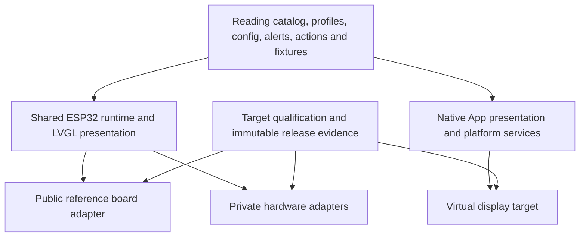

# Shared platforms and hardware-qualified releases

Owner direction, 2026-10-20. This is the extension contract and phased plan;
existing runtime and wire formats remain unchanged. [Current state](../current-state.md)
owns installed/observed behavior; [backlog](../backlog.md) owns implementation status.

## Repository and distribution boundary

- `ESP32OBD2` remains the shared product/reference implementation. Only the original
  `waveshare-esp32-s3-touch-lcd-1.28` is eligible for free public firmware downloads.
  [Platform policy](../../contracts/platform-policy.json) is the machine-readable authority.
  Its validator runs in host lint and before the public development release workflow.
- [ESP32OBD2-platforms](https://github.com/lstepnio/ESP32OBD2-platforms) is private.
  It owns additional board descriptors, integration code, exact core pins,
  target qualification and private release artifacts. Keep one integration repository,
  not a fork/branch per board. Do not use the secrets vault as a source repository.
- Keep private overlays outside the public checkout. Public CI, PRs, logs, artifacts,
  GitHub Releases, website downloads and recovery manifests must not carry their
  firmware or sources. A draft/prerelease or an obscure URL is not access control.
- A private release is not automatically paid, and general availability does not mean
  public download. Customer access/distribution requires a separate reviewed path;
  never embed a GitHub token or signing secret in an App or browser bundle.
- Published source and upstream licenses remain available independently of our binary
  distribution policy. Private hosting cannot prevent third-party rebuilds of public
  code. Preserve notices and review dependencies for each distributed artifact;
  do not change licenses or claim technical copy protection from this structure.

The current public workflow is still reference-board development-only. This change
creates no stable/RC publisher, private delivery service, signing key or entitlement
system, and does not withdraw historical public releases.

## Share behavior, isolate hardware

Keep feature logic independent of board names. The firmware core owns sampling,
source freshness, diagnostics, alerts, actions, configuration, recovery and update
state. Small adapters own display/flush, touch, brightness, power and optional devices.
Use the existing BSP and owners first; extract a seam when the second target needs it.
No wholesale directory move, dependency upgrade, runtime plugin loader or universal HAL.

The private integration pins an exact public core commit with a Git submodule.
Update that pin through a reviewed PR; never build a release against floating `main`.
After core changes merge, each target rebuilds and qualifies separately. Where a
private port needs a reusable seam, contribute the generic seam back to the shared
core and retain only hardware adaptation privately. Do not cherry-pick feature
implementations into permanent hardware forks.

LVGL and Compose remain native renderers. Share semantic page definitions, units,
severity, formatting rules and conformance fixtures rather than forcing the same
widget implementation or graphics stack onto ESP32 and Android. Reuse existing
C/Kotlin logic; share native modules only when that removes measured duplication
without introducing a second lifecycle/ownership model.

## Target descriptor and feature admission

Separate three identities: runtime family, exact board/revision, and display surface.
`esp32s3` alone cannot identify a board. Candidate SKU is purchasing metadata, not
runtime identity. A descriptor must record:

| Area | Required facts and rules |
| --- | --- |
| Identity | Stable target ID; exact revision range; board implementation and core/toolchain/dependency pins; default private audience |
| Surface | Native width/height, round/rectangle shape, visible-area mask/insets, pixel format and display transport; rotation and touch-coordinate mapping |
| Input/output | Touch/buttons, brightness mechanism, optional IMU/audio/RTC; supported/unsupported driver operations; no fabricated sensor values |
| Resources | Internal/DMA/PSRAM placement and measured margins; bounded draw buffers, histories and queues; measured refresh target and radio workload |
| Compatibility | Config/protocol versions, feature requirements, partition geometry, image identity and recovery method |

A feature is exposed only when declared hardware, healthy runtime detection,
implemented driver support, compatible configuration, resource admission and target
qualification agree. Unsupported capability is distinct from temporarily unavailable.
Do not use a paid-feature flag as a substitute for hardware capability or safety.
Keep existing public capability gates unchanged until their full paths are qualified.

Optional peripherals stay off unless a feature needs them. Extra PSRAM does not
increase the internal SRAM needed by radio/DMA/critical stacks. SPI/QSPI partial
updates and continuously scanned RGB displays need different buffer policies;
qualify RGB under flash writes and Wi-Fi load, not only an idle animation.

## Layouts across round, square and larger surfaces

Replace fixed 240 px geometry at the presentation seam with surface metrics.
Preserve normalized semantic placement, readable type, bounded text and safe areas;
regenerate fonts for native sizes. Do not enlarge a bitmap of the original screen.
Round layouts obey a circular mask; rectangular displays can reflow tiles and use
corners. Keep template/channel/config bounds unchanged until separately reviewed.
New space does not imply arbitrary scripts, extra polling or unbounded histories.

Gesture thresholds use physical/normalized distances and time windows rather than
raw pixels. Coordinate transforms and rendered rotation must agree. Features that
need deliberate local input must have an equivalent qualified interaction on every
target; do not silently turn a physical confirmation into an unattended command.

App virtual displays are a separate target, not an ESP32 BSP. Start with existing
Compose presentation and synthetic fixtures. A future gauge-fed virtual display
needs the not-yet-qualified live telemetry path and retains gauge-owned sampling
and alert truth. A phone-only gauge needs a separate adapter/session owner and
Android background/reconnect qualification. Choose one sampling/alert authority per
session to avoid duplicate events or competing adapter connections. Preview pixels
are not live telemetry. Neither virtual mode is implemented by this plan.

## Reference-first development and target-specific qualification

1. Specify the common behavior and fixture once; implement the feature on the
   existing 1.28-inch reference board first, using the established build/test flow.
2. Exercise capability absence, resource limits, round/rectangular surfaces and
   alternate sizes in host/emulator checks. These establish logic, not hardware support.
3. Update the private core pin; bring up power, display, touch and brightness on the
   selected physical board before enabling additional features.
4. Qualify that board's single/dual adapter plus phone workload, retained setup,
   gesture/alert legibility, update interruption/rollback/USB recovery, memory and
   sustained operation. Reuse existing matrices, recording target-specific evidence.
5. Promote only the tested capability subset. Hardware-specific features unavailable
   on the reference board require tests on hardware that actually has them.

## Release candidates and promotion

Audience (`public`, `internal`, `customer`) and maturity (`development`, `rc`, `ga`)
are independent. Every new target starts private and unqualified. These are planned
release-process states, not new fields in the current protocol-0 catalog.

| State | Entry/exit evidence |
| --- | --- |
| Development | Exact source/toolchain/dependency/target pins; green checks; clearly scoped hardware observations; private artifacts for new boards |
| Release candidate | Immutable signed image digest; exact hardware range/layout/config/protocol; feature/limitation matrix; target memory/recovery/soak evidence; known issues and last-known-good rollback/recovery package |
| General availability | Owner approves that exact candidate for the stated target/revisions/audience; acceptance evidence complete for enabled features; staged distribution and withdrawal/rollback path ready |

Promote the same tested image hash; a rebuild or changed driver/config creates a new
candidate. Sign catalog/promotion metadata with monotonic sequencing and preserve
existing trust/anti-rollback rules. Existing development sequences/channels keep
their meanings; adding private trust namespaces or RC catalogs needs a reviewed
protocol/client migration. No board inherits another board's qualification.

Future signed metadata must bind exact target/revision, partition layout and image
hash. Both updater and firmware must enforce compatibility. ESP32 chip identity
alone cannot establish board identity; USB ROM flashing cannot infer attached
hardware. Use explicit target selection/provisioning and a separately qualified
recovery package. The current legacy board tag is not a universal multi-board ID.

## Implementation order and tradeoffs

[PLATFORM-03](../backlog.md) tracks the remaining slices: preserve the public baseline;
extract board/surface seams with unchanged reference screenshots; bring up one private
AMOLED target; adapt templates/fonts and qualify radio/update behavior; add the RGB
or rectangular target; then virtual-display and private RC delivery slices.

This keeps one product behavior and small ports, at the cost of per-target release
work and two native presentation backends. A universal renderer or early mass HAL
rewrite would increase risk before a second working board establishes real seams.
