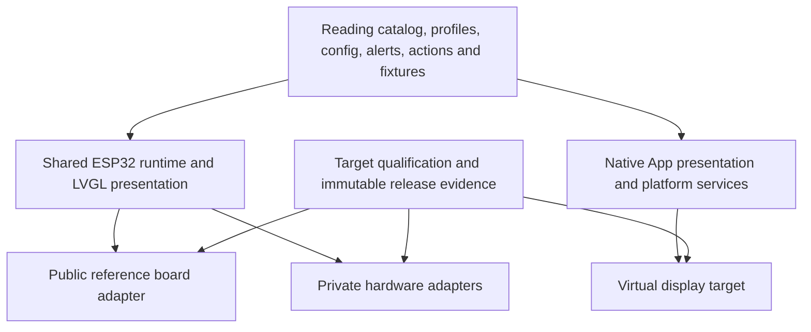

# Shared platforms and hardware-qualified releases

Owner direction, 2026-10-20. This is the extension contract and phased plan;
existing runtime and wire formats remain unchanged. [Current state](../current-state.md)
owns installed/observed behavior; [backlog](../backlog.md) owns implementation status.

## Repository and distribution boundary

- `ESP32OBD2` remains the shared product/reference implementation. Only the original
  `waveshare-esp32-s3-touch-lcd-1.28` is eligible for free public firmware downloads.
  [Platform policy](../../contracts/platform-policy.json) is the machine-readable authority.
  Its validator runs in host lint and before the public development release workflow.
- [ESP32OBD2-platforms](https://github.com/lstepnio/ESP32OBD2-platforms) is private.
  It owns additional board descriptors, integration code, exact core pins,
  target qualification and private release artifacts. Keep one integration repository,
  not a fork/branch per board. Do not use the secrets vault as a source repository.
- Keep private overlays outside the public checkout. Public CI, PRs, logs, artifacts,
  GitHub Releases, website downloads and recovery manifests must not carry their
  firmware or sources. A draft/prerelease or an obscure URL is not access control.
- A private release is not automatically paid, and general availability does not mean
  public download. Customer access/distribution requires a separate reviewed path;
  never embed a GitHub token or signing secret in an App or browser bundle.
- Published source and upstream licenses remain available independently of our binary
  distribution policy. Private hosting cannot prevent third-party rebuilds of public
  code. Preserve notices and review dependencies for each distributed artifact;
  do not change licenses or claim technical copy protection from this structure.

The current public workflow is still reference-board development-only. This change
creates no stable/RC publisher, private delivery service or signing key, and does
not withdraw historical public releases.

## Share behavior, isolate hardware



Keep feature logic independent of board names. The firmware core owns sampling,
source freshness, diagnostics, alerts, actions, configuration, recovery and update
state. Small adapters own display/flush, touch, brightness, power and optional devices.
Use the existing BSP and owners first; extract a seam when the second target needs it.
No wholesale directory move, dependency upgrade, runtime plugin loader or universal HAL.

The private integration pins an exact public core commit with a Git submodule.
Update that pin through a reviewed PR; never build a release against floating `main`.
After core changes merge, each target rebuilds and qualifies separately. Where a
private port needs a reusable seam, contribute the generic seam back to the shared
core and retain only hardware adaptation privately. Do not cherry-pick feature
implementations into permanent hardware forks.

LVGL and Compose remain native renderers. Share semantic page definitions, units,
severity, formatting rules and conformance fixtures rather than forcing the same
widget implementation or graphics stack onto ESP32 and Android. Reuse existing
C/Kotlin logic; share native modules only when that removes measured duplication
without introducing a second lifecycle/ownership model.


## Platform feature flags

| Build feature | Free reference LCD | Private product builds |
| --- | --- | --- |
| `EGAUGE_FEATURE_DUAL_ADAPTER` | Off. One OBD-II adapter | Opt in to a separate child adapter |
| `EGAUGE_FEATURE_SMART_CYCLE` | Off. Timed cycling remains | Opt in to reading-driven page selection |
| `EGAUGE_FEATURE_VEHICLE_ACTIONS` | Off. Page-jump gestures remain | Opt in to vehicle Action Pages and command admission |

The CMake switches are independent, default off in the shared component, and
can be selected by a private product project. An enabled action feature does
not qualify a vehicle or enable the supervised owner-test switches. The public
release workflow verifies all three switches are off. This is a product build
policy. The shared implementation remains available as source.

The App projects a setup against the selected gauge's advertised capabilities.
It retains the user's private feature assignments on the phone. On firmware
with a restricted profile, a previously saved two-adapter setup runs with
only the engine adapter and preserves the dashboard. Readings sourced solely
from the disabled child show as unavailable. Saved vehicle-action gestures
do not open an action menu. A saved Smart preference falls back to timed
cycling with the same interval. Firmware reads retain the original document
revision and digest, and disabled features are rejected in new writes.
See the [wire capability contract](../protocol/experimental-firmware-transfers.md#platform-feature-policy).

## OLED entitlements

The OLED bundle pairs one board with an offline, unit-bound entitlement. The
shared catalog and dashboard behavior remain common. A board's capabilities and
the compiled feature set form the ceiling for any licensed option. Runtime
vehicle-command qualification still applies independently.

The bench issuer/verifier `tools/board_license.py` signs a fixed-format envelope
using a separate P-256 key. It reads the factory ESP32-S3 eFuse MAC from standard
input. Obtain it during private provisioning using Espressif's
`esp_efuse_mac_get_default` and keep it out of public logs. The unit ID is SHA-256
over the ASCII bytes `egauge/esp32s3/factory-mac/v1`, a zero byte, and the six MAC
bytes. Treat the derived ID as a private identifier too.

The signed payload is eight magic bytes (`EGOLIC1` plus a zero byte), the 32-byte
unit ID, then a one-byte feature mask. The trailing DER ECDSA signature covers
the entire payload with SHA-256. The magic scopes version 1 to the OLED product.
Bits 0, 1 and 2 grant dual-adapter, Smart Cycle and Vehicle Actions respectively.
Unknown bits and a different unit, product or signature are rejected. The format
has no expiry. Any future expiry, revocation, or transfer policy needs its own
contract and qualification.

Example fulfillment trial, using private files and an offline signing machine:

```sh
python tools/board_license.py issue --signing-key /private/issuer.pem \
  --feature dual-adapter --feature smart-cycle board.egauge-license < factory-mac.txt
python tools/board_license.py verify --verification-key /private/issuer-public.pem \
  board.egauge-license < factory-mac.txt
```

### Private OLED candidate

A private product build opts in with
`-DEGAUGE_OLED_LICENSE_PUBLIC_KEY=/absolute/private/issuer-public.pem`.
Use a separate P-256 verifier from the firmware-update trust key. The reference
project rejects the option. Ordinary private development builds with the
option unset retain their existing compile-time policy.

The licensed build reads its factory eFuse MAC and verifies the entitlement
once, before configuration and BLE startup. Missing, unreadable, corrupted
or mismatched data yields an empty paid-feature set. The verified mask is
intersected with the compiled feature ceiling. Existing BLE discovery reports
that effective set. Stored setup bytes and digests survive restriction and
restore. New disabled-feature requests are rejected, and loss of a license
never authorizes discarding a retained vehicle-action record. The existing
vehicle-command qualification and recovery rules continue to apply.

Use the private AMOLED project's A/B build and pin the reviewed shared core
commit. Copy the shared `firmware/gauge/partitions.csv` to the private project's
`product/amoled/partitions-licensed.csv` and add this row after `ota_1`:

```csv
eg_entitle,data,nvs,0x660000,0x3000,readonly
```

In the private project, set the A/B branch's `amoled_partition_file` to the
absolute path of that new CSV, using
`${CMAKE_CURRENT_LIST_DIR}/partitions-licensed.csv` instead of the shared path.
Create a private candidate defaults file with
`CONFIG_PARTITION_TABLE_CUSTOM_FILENAME="/absolute/private/product/amoled/partitions-licensed.csv"`.
With ESP-IDF 5.4.1 active, build the private project without owner action switches:

```sh
idf.py -C "$private_repo/product/amoled" -B "$private_work/build" \
  -DIDF_TARGET=esp32s3 -DEGAUGE_BUILD_AB_LAYOUT=1 \
  -DEGAUGE_CANDIDATE_DEFAULTS="$private_work/entitlement.sdkconfig.defaults" \
  -DEGAUGE_PROTOCOL_BOARD_NAME=EGS-AMOLED-175B \
  -DEGAUGE_OLED_LICENSE_PUBLIC_KEY="$private_work/issuer-public.pem" build
```

The private wrapper's existing exact-layout receipt must be extended before
it can attest this added partition. The reference table stays unchanged.
The entitlement occupies a dedicated read-only NVS partition, separate
from the application slots, pairing NVS and both configuration generations.
Normal app-slot updates preserve it. Recovery must use the same licensed
layout and exclude the entitlement region from ordinary writes. A whole-chip
erase requires re-provisioning from the retained, verified board license.

### Provisioning and acceptance

Keep the factory MAC, signed license, flash readbacks and provisioning workspace
private. Read the connected board's factory MAC using the pinned ESP-IDF
`esptool.py --chip esp32s3 --port "$oled_port" read_mac` operation, capture the
six-byte value in `factory-mac.txt`, and verify the paid order's license against
that MAC and the build's embedded public key using the verifier above.

The entitlement image is an ESP-IDF NVS blob. Use a private directory and
an absolute comma-free filename for the binary license:

```sh
umask 077
printf 'key,type,encoding,value\nlicense,namespace,,\nentitlement,file,binary,%s\n' \
  "$private_work/board.egauge-license" > "$private_work/entitlement.csv"
python "$IDF_PATH/components/nvs_flash/nvs_partition_generator/nvs_partition_gen.py" \
  generate "$private_work/entitlement.csv" "$private_work/entitlement.bin" 0x3000
```

USB installation requires owner authorization and the OLED-specific
[USB recovery procedure](../development/firmware-release-runbook.md).
After the reviewed licensed partition table is installed, compare the board's
partition table to the exact build and verify the NVS image size before writing.
Run the following in order and stop if any command fails:

```sh
esptool.py --chip esp32s3 --port "$oled_port" read_flash 0x8000 0xc00 \
  "$private_work/partition-table-readback.bin"
cmp "$private_work/build/partition_table/partition-table.bin" \
  "$private_work/partition-table-readback.bin"
test "$(wc -c < "$private_work/entitlement.bin")" -eq 12288
python "$IDF_PATH/components/partition_table/parttool.py" --port "$oled_port" \
  write_partition --partition-name eg_entitle --ignore-readonly \
  --input "$private_work/entitlement.bin"
python "$IDF_PATH/components/partition_table/parttool.py" --port "$oled_port" \
  read_partition --partition-name eg_entitle --output "$private_work/entitlement-readback.bin"
cmp "$private_work/entitlement.bin" "$private_work/entitlement-readback.bin"
```

With ESP-IDF 5.4.1 active, run
`python -m unittest tools.tests.test_oled_firmware_license` from the shared
repository. The test links the production boot verifier against the pinned
Mbed TLS library and feeds it host-issued licenses through simulated NVS and
factory-MAC reads.

On physical OLEDs, verify cold-boot activation, effective BLE capabilities and
configuration admission on the intended board. Exercise wrong-board and wrong-key
rejection, missing and corrupted data, authorized replacement, and survival across
an update, rollback and scoped USB recovery. Verify both customer app slots enforce
the same licensing policy. Keep customer distribution gated on this evidence.
The factory MAC is a stable, readable ID. Resistance to modified firmware or
cloning requires separate secure-boot and device-key provisioning. Reading the
factory ID and provisioning this NVS partition require no eFuse writes.

## Implemented reference interfaces

`gauge_board.h` is the ESP32/LVGL board boundary. The reference adapter delegates
bootstrap, rotation, panel power and brightness to the unchanged BSP. The existing
startup order, error policy, PWM settings, touch setup and LVGL ownership remain.
`EGAUGE_BOARD_ADAPTER_SOURCE` selects one implementation at configure time; its
default is the public reference adapter. Private builds can supply an absolute
source path and their own reviewed dependencies without editing application logic.
This hook does not provision board identity, authorize publication or qualify a port.
Public CI/release builds use the clean reference configuration.

`gauge_surface.h` supplies immutable shape/dimension/inset metrics and pure native
safe-area checks. Round and rectangular geometry are sanitizer-tested, including
odd dimensions and overflow boundaries. `gauge_layout_fits` remains a reference-only
compatibility helper; the compositor uses the selected presentation surface.

`gauge_presentation.h` links one immutable surface, six semantic font roles and native
vector paths. `EGAUGE_UI_PROFILE_SOURCE` selects its provider; the default retains
all original reference resources. `EGAUGE_UI_FONT_SOURCES` replaces the complete font
set so private targets do not also link unused reference glyphs. Providers and fonts
for additional boards stay in the private repository. Normal builds need no font converter.
The existing pinned font procedure owns rasterization/license rules.

The shared composition converts its design grid to native integer coordinates on a
centered square canvas. Font ink is measured at its native raster size against the
selected surface; bitmap transforms are never used. Strokes, charts, icons, hit areas
and calibration geometry use the same conversion. Page-action input is converted
back to the original design grid, preserving gesture distances and timing. Rectangular
surfaces currently center this composition; tile reflow is future work, not automatic.

Startup requires a complete profile matching the board's shape, dimensions and insets;
UI creation also checks the active LVGL resolution. A board driver alone cannot select
larger templates. Profile admission is a source/configuration check, not qualification
or release authorization. Rotation/touch mapping, resource budgets, dependencies and
board identity still need target-specific work. Use a bring-up harness until those
paths exist.

No new runtime heap buffers, tasks, locks, protocol fields or advertised capabilities
are introduced by these seams. Production LVGL host frames are compared against the
captured reference, separately from the linked firmware/memory checks. Alternate-size
renders do not establish alternate-board firmware support. The host renderer can use
an explicitly pinned LVGL source through `EGAUGE_LVGL_SOURCE_DIR`; this does not change
firmware dependency resolution.

## Target descriptor and feature admission

Separate three identities: runtime family, exact board/revision, and display surface.
`esp32s3` alone cannot identify a board. Candidate SKU is purchasing metadata, not
runtime identity. A descriptor must record:

| Area | Required facts and rules |
| --- | --- |
| Identity | Stable target ID; exact revision range; board implementation and core/toolchain/dependency pins; default private audience |
| Surface | Native width/height, round/rectangle shape, visible-area mask/insets, pixel format and display transport; rotation and touch-coordinate mapping |
| Input/output | Touch/buttons, brightness mechanism, optional IMU/audio/RTC; supported/unsupported driver operations; no fabricated sensor values |
| Resources | Internal/DMA/PSRAM placement and measured margins; bounded draw buffers, histories and queues; measured refresh target and radio workload |
| Compatibility | Config/protocol versions, feature requirements, partition geometry, image identity and recovery method |

A feature is exposed only when declared hardware, healthy runtime detection,
implemented driver support, compatible configuration, resource admission and target
qualification agree. Unsupported capability is distinct from temporarily unavailable.
Do not use a paid-feature flag as a substitute for hardware capability or safety.
Keep existing public capability gates unchanged until their full paths are qualified.

Optional peripherals stay off unless a feature needs them. Extra PSRAM does not
increase the internal SRAM needed by radio/DMA/critical stacks. SPI/QSPI partial
updates and continuously scanned RGB displays need different buffer policies;
qualify RGB under flash writes and Wi-Fi load, not only an idle animation.

## Layouts across round, square and larger surfaces

Replace fixed 240 px geometry at the presentation seam with surface metrics.
Preserve normalized semantic placement, readable type, bounded text and safe areas;
regenerate fonts for native sizes. Do not enlarge a bitmap of the original screen.
Round layouts obey a circular mask; rectangular displays can reflow tiles and use
corners. Keep template/channel/config bounds unchanged until separately reviewed.
New space does not imply arbitrary scripts, extra polling or unbounded histories.

Gesture thresholds use physical/normalized distances and time windows rather than
raw pixels. Coordinate transforms and rendered rotation must agree. Features that
need deliberate local input must have an equivalent qualified interaction on every
target; do not silently turn a physical confirmation into an unattended command.

App virtual displays are a separate target, not an ESP32 BSP. Start with existing
Compose presentation and synthetic fixtures. A future gauge-fed virtual display
needs the not-yet-qualified live telemetry path and retains gauge-owned sampling
and alert truth. A phone-only gauge needs a separate adapter/session owner and
Android background/reconnect qualification. Choose one sampling/alert authority per
session to avoid duplicate events or competing adapter connections. Preview pixels
are not live telemetry. Neither virtual mode is implemented by this plan.

## Reference-first development and target-specific qualification

1. Specify the common behavior and fixture once; implement the feature on the
   existing 1.28-inch reference board first, using the established build/test flow.
2. Exercise capability absence, resource limits, round/rectangular surfaces and
   alternate sizes in host/emulator checks. These establish logic, not hardware support.
3. Update the private core pin; bring up power, display, touch and brightness on the
   selected physical board before enabling additional features.
4. Qualify that board's single/dual adapter plus phone workload, retained setup,
   gesture/alert legibility, update interruption/rollback/USB recovery, memory and
   sustained operation. Reuse existing matrices, recording target-specific evidence.
5. Promote only the tested capability subset. Hardware-specific features unavailable
   on the reference board require tests on hardware that actually has them.

## Release candidates and promotion

Audience (`public`, `internal`, `customer`) and maturity (`development`, `rc`, `ga`)
are independent. Every new target starts private and unqualified. These are planned
release-process states, not new fields in the current protocol-0 catalog.

| State | Entry/exit evidence |
| --- | --- |
| Development | Exact source/toolchain/dependency/target pins; green checks; clearly scoped hardware observations; private artifacts for new boards |
| Release candidate | Immutable signed image digest; exact hardware range/layout/config/protocol; feature/limitation matrix; target memory/recovery/soak evidence; known issues and last-known-good rollback/recovery package |
| General availability | Owner approves that exact candidate for the stated target/revisions/audience; acceptance evidence complete for enabled features; staged distribution and withdrawal/rollback path ready |

Promote the same tested image hash; a rebuild or changed driver/config creates a new
candidate. Sign catalog/promotion metadata with monotonic sequencing and preserve
existing trust/anti-rollback rules. Existing development sequences/channels keep
their meanings; adding private trust namespaces or RC catalogs needs a reviewed
protocol/client migration. No board inherits another board's qualification.

The board descriptor's update tag gates the [shared development OTA worker](../protocol/experimental-firmware-transfers.md#development-owner-protocol-0).
The reference LCD keeps its existing tag, bundle and installer compatibility.
The host board fixture checks reference and alternate target matching, including
unset and mismatched tags (`python -m unittest tools.tests.test_gauge_platform`).

Before enabling OTA for a private board, qualify a rollback-capable A/B layout
and recovery image, allocate a distinct tag for the compatible hardware and
layout, and wire it through protected signing and the private catalog and
installer. Provision the corresponding verification key in the gauge and
installer. The installer must identify the attached target and select only the
compatible image. Signed release metadata must bind exact target/revision,
partition layout and image hash. ESP32 chip identity alone cannot establish board
identity; USB ROM flashing requires explicit target selection and a qualified
recovery package. Qualify wrong-target rejection, update, interruption and
rollback on the actual board before promotion.

## Implementation order and tradeoffs

[PLATFORM-03](../backlog.md) tracks the remaining slices: preserve the public baseline;
extract board/surface seams with unchanged reference screenshots; bring up one private
AMOLED target; adapt templates/fonts and qualify radio/update behavior; add the RGB
or rectangular target; then virtual-display and private RC delivery slices.

This keeps one product behavior and small ports, at the cost of per-target release
work and two native presentation backends. A universal renderer or early mass HAL
rewrite would increase risk before a second working board establishes real seams.
