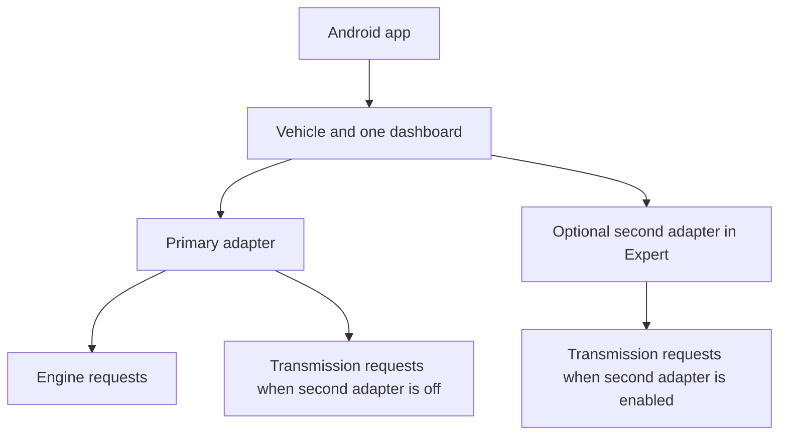

# Vehicles and adapter routing

Updated 2026-10-07. One vehicle dashboard is independent of its physical adapters.

## Product model

A phone stores up to eight vehicles and sixteen remembered gauges. Every vehicle
has one primary logical connection, ECM, and one dashboard containing its supported
engine and transmission readings. A swap may explicitly enable one optional second
adapter in Expert. It belongs to the primary vehicle; it is never a second car.

One adapter is the normal case. All configured definitions use that transport,
keeping their own CAN request/response identities. A second adapter only changes
where transmission definitions are polled. No page editor, preview, Actions picker
or send review selects an ECM-only or TCM-only subset.

Each physical connection recovers independently. Missing engine data cannot prevent
transmission data from displaying, or the reverse. Keep pages visible with unavailable
values for absent data. Do not erase source/ECU identity in parsing, diagnostics,
commands or freshness merely because the product has one logical connection.

## Android implementation

`VehicleProfile` retains primary and internal child drafts for backward-compatible
storage. `dashboardDraft()` is the logical editor; it includes both page sets and
legacy TCM-only profiles. `withDashboard()` stores edits without changing bindings.
`projectVehicle()` sends every dashboard page and changes only definition routing
when the second adapter is enabled. Mixed-controller Dual pages are supported by
new firmware. Page order and gesture targets survive route changes.

Expert selection edits a binding, never a page source. **Second adapter** opens a
focused picker directly, even when the primary binding was previously selected.
It starts one bounded discovery when the gauge is ready, offers an explicit rescan,
and marks the primary radio unavailable for child selection. Missing selection,
disconnection and unsupported firmware have separate explanations. Child selection
captures vehicle identity before the serialized save, requires an existing child,
and never falls back to writing the primary binding. Car always edits the primary
binding. Reconnection restores the whole vehicle editing context. Actual installed
source roles drive protected status polling until a reviewed replacement is sent.
Each remembered gauge retains its vehicle association and explicit second-adapter
mode. Separate vehicles and gauges never inherit one another's bindings.

Profile schema 14 retains mixed primary pages and reads schemas 1..14. Coupled
vehicle/gauge assignments commit together; see [Android storage](android-runtime.md#storage-and-recovery). Child page
identities keep their existing `child.` prefix; this is an internal identity rather
than a separate dashboard. A legacy TCM profile keeps its ID and binding, offers
engine readings, and normalizes its primary draft when edited. It does not guess
which other saved car is its parent. Explicit legacy attachment remains available
for recovering an older separate profile. Confirmed protected single/dual gauge
readback can recover a missing vehicle without overwriting an existing ID.

A vehicle keeps at least one page, and the phone keeps at least one vehicle. A
controller's internal draft may be empty. Both configured adapters can still check
faults without having a display page assigned. Unfinished or same-radio child
bindings cannot enable two workers; single mode uses the primary transport for the
whole dashboard. Removing a child route retains all pages/gestures.

## Firmware and compatibility

Development capability `va:1` means: request service and expected responder belong to each
PID, with bounded serialized CAN header changes. Sources describe transports.
One transport can carry standard 7E8 and captured enhanced 7E9 requests. A second
source routes the enhanced definitions to its independent worker. Public link
capacity remains one until the physical coexistence matrix passes.

Configuration schema remains 2. An older firmware lacks `va:1`; Android blocks the
new mixed/second-adapter payload rather than dropping pages. Older phone Apps reject
new schema-12 storage. Firmware freshness, source generations and unknown replies
continue to fail closed. `cfg:5` implements TCM numeric and gear alerts; their real-vehicle qualification
remains pending. TCM faults on a shared primary transport need the **QUAL-05** review
in the [backlog](../backlog.md). Existing enhanced definitions remain calibration-specific.

See [detailed review and test plan](../evidence/logical-vehicle-review.md) and
[dual recovery matrix](../development/dual-adapter-recovery.md).

## Deleting phone data

Customize and Manage pages expose confirmed page deletion. Target gestures are
cleared, reading alerts remain, and a reviewed send changes the gauge.

Car > Your car exposes confirmed vehicle deletion. Persistence must succeed before
selection changes. Pending setup/update outcomes block deletion. Installed settings
and bonds remain unchanged; affected remembered gauges need explicit reassignment.
Choosing a different vehicle resets that gauge's local second-adapter mode. Other
gauges keep their own assignments. Corrupt associations fail closed and remain
recoverable; they never silently select another vehicle.

## Role verification for accidentally swapped adapters

Bluetooth identity identifies the transport, not the module behind it. Single
adapter operation is unchanged. For two saved, distinct, real primary/child
bindings, the gauge clears retained adapter receive/flow filters and performs an
optional bounded functional support request to establish the CAN protocol without
assuming either module role. It then reads Mode 09 calibration
and CVN at exact responders 7E8 and 7E9. Only the captured Jeep pair can exchange
roles: ECM `68059434AD` / `CA36378C`, TCM `68274867AE` / `8240DAE8`.
The [ECM](../evidence/jeep-actions-live-qualification.md) and
[TCM reference](../development/tcm-session-resume.md) retain the evidence.
A generic PID reply, device name, negative response or timeout is insufficient.

Both peers must produce fresh, complete, opposite-only matches within 15 seconds
of each other before one runtime exchange. Both workers retire their contexts,
source epochs, cached values, diagnostics and presentation state before the inverse
address map becomes visible. No saved configuration, Bluetooth bond or profile is
rewritten. Logical source 0 remains ECM; source 1 remains its TCM child. The inverse
map remains stable across reconnect; reboot re-verifies the saved bindings.

Missing/ambiguous matches and ports exposing both modules retain the current map
and ordinary telemetry. No other nearby adapter is discovered or auto-bound.
Each cycle runs one fixed read per ordinary worker iteration, after command I/O:
first protocol discovery allows up to 15 seconds, subsequent reads one second,
and a complete cycle has a 20-second bound. Unknown/opposite roles retry after
30 seconds; a correct-role proof stops repeated identity polling for that BLE
generation. A stale opposite pair requests a paced fresh comparison, never a swap
on old evidence. An outstanding prompt drains before another request. Deferred
support pages retry failures with capped 1/2/4/8-second backoff and finish only on
a successful terminal reply. Identity/support share one background-I/O slot per loop. No ECU session, actuator or configuration write is part
of role probing; AT commands only select the adapter's request/response route.

A complete positive ECM identity establishes a source-generation-scoped primary
proof, including when the same port also exposes TCM. Mere refresh timeouts do not
clear it. Retirement or a positively different identity does. Vehicle actions still
require the independent exact ECM admission policy; ECM identity is not ABS
controller identity. There is no automatic Start or control replay on exchange.
Offline policy/production transport tests cover role combinations, stale epochs,
missing/ambiguous replies, inverse-map continuity, prompt draining and callback
retirement. Physical swapped-port/loaded recovery remains qualification work.
