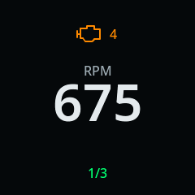
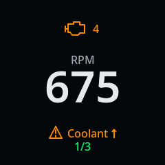

# Gauge browsing and shortcut reliability review

> Historical evidence. Findings and verification below describe this session.
> Current support is in [current state](../current-state.md); remaining work is in
> [the backlog](../backlog.md). These notes are not standing implementation instructions.

Dated source and host-test evidence, 2026-10-19. This report is not installed-device
qualification. [Current state](../current-state.md) owns installed behavior;
[QUAL-13](../backlog.md) owns remaining acceptance. Architecture lives in
[firmware ownership](../architecture/firmware-runtime.md#live-readings-across-page-changes)
and [local actions](../architecture/vehicle-actions.md#lightweight-interaction).

## Observation and findings

The owner reports a good in-vehicle display overall, dashes immediately after page
changes until a refresh, and an inconsistent upward shortcut that worked indoors.
The exact image identity, settings, stroke timing and touch trace were not collected
in this session. No phone or gauge was modified or tested.

| Source finding | Effect | Prepared correction |
| --- | --- | --- |
| `ui_set_page` clears samples and queued readings; `ui_task` discards hidden-page data | A fresh recent reply cannot populate the next page | Fixed latest-value cache, immediate fresh render through the shared page path |
| Every pairing mailbox message resets the recognizer, including HIDDEN while already hidden; phone disconnect publishes HIDDEN | A routine phone session change can silently erase a partly completed gesture | Reset on actual pairing state changes |
| A rejected swipe returns false; LVGL emits RELEASED then CLICKED | A failed stroke can advance the page and reset the sequence | Separate tap/browse/stroke intent; consume rejected upward motion |
| Pairing hold arbitration requires 32 px travel before long-press arrives | A slow stroke moving less than 32 px can open pairing | Motion over 12 px suppresses stationary hold behavior |
| 80 ms minimum stroke duration | Deliberate 60 ms flicks fail despite sufficient travel | 40 ms minimum, retain distance/direction/path checks and 800 ms ceiling |
| Progress/result is hidden whenever CEL/faults are present | In-vehicle attempts lose feedback available indoors | Bottom progress lane independent of CEL; alerts retain priority |
| Pending state is published only on the UI timer; cycling checks before acquiring LVGL | A stroke can lose a race to a due automatic page change | Immediate pending publication and eligibility recheck under LVGL lock |
| No PRESS_LOST cleanup | Interrupted input can leave partial recognizer state | Cancel press/progress and suppress a following click |

These defects are reproducible software paths. They are plausible contributors to
the owner's observation, not proof of which path occurred in the Jeep. Missing
controller interrupts, radio/CPU contention, vibrations, orientation and human
stroke variation remain unmeasured. The pinned LVGL input implementation and
ESP touch bridge were inspected; managed components and touch-controller settings
were not changed.

## Page data options

| Approach | Benefit | Cost or risk | Decision |
| --- | --- | --- | --- |
| Latest fresh values across all configured PIDs | Immediate first frame when data already exists; no extra adapter traffic | Must preserve identity, age and invalidation | Implemented in this change |
| Raise visible/next-page polling priority | Helps genuinely overdue readings | More scheduler coupling; can starve hidden alerts or diagnostics without fairness limits | Measure first; no scheduler change here |
| Hold old values until replacement | Visually populated on loss | Old data can look current and hide an absent adapter | Rejected for ordinary live readings |
| Delay page changes until a reply | First frame has fresh data | Touch lag, inconsistent intervals and unavailable-adapter blocking | Rejected |

The cache replaces the old 32-entry sample FIFO. Entries are fixed and bounded;
there is no additional task, persistent state or page-time allocation. All updates
coalesce to the latest sample. Original stale deadlines, invalid samples and
source-session fencing still produce dashes. It cannot manufacture a reading that
has never arrived, or conceal overload in an oversized/slow PID set. Trend history
still starts on page entry; its current number can populate immediately.

## Shortcut UX choices

Keep the saved count/window/target and five-second cooldown for this iteration.
Clear feedback and input arbitration address several defects without introducing
another control mode. Ordinary taps, horizontal browsing, stationary pairing holds
and unconfigured swipe browsing retain their existing purpose.

The strongest concern with triple swiping remains the interaction itself: it needs
three separately detected releases on a small screen. Software fixes cannot make
it independent of reach, gloves, moisture or vibration. Alternatives:

- **Two upward strokes:** already configurable in the App, less effort but easier
  to trigger accidentally. Compare after the repaired three-stroke baseline.
- **One upward stroke opening a favorite-page choice:** clearer and less repeated
  motion, but adds a visible interaction step and needs separate design approval.
- **Longer hold or double tap:** reuses a competing pairing/browsing gesture and
  complicates timing. Do not substitute it as an unmeasured shortcut fix.
- **A different touch driver or faster scan rate:** only pursue after capturing
  missed/late events. It adds hardware and load risk without evidence today.

The recommendation is the scoped repair first. Do not broaden geometry or remove
noise rejection to claim reliability. If loaded capture still shows misses, extend
the existing bounded health/performance logging with stroke duration/displacement
and rejection counts before tuning the next threshold. This local-page recognizer
does not qualify or enable vehicle-control actions.

## Native layout examples

Simulated data, rendered by the production UI/fonts at 240 × 240. These are host
frames, not photographs or on-gauge verification. CEL, threshold condition and
shortcut progress occupy distinct lanes.

## Focused verification

- Sanitized pure recognizer fixtures: expiry/inclusive window, cooldown, wrap,
  orphan release, rejected hold/noise/reverse/diagonal and a deliberate 60 ms stroke.
- Real production LVGL UI and fonts with a synthetic pointer: actual release/click
  ordering, taps, horizontal browsing, unconfigured swipe browsing, 60 ms and slow
  swipes, lost press, repeated phone HIDDEN, CEL-visible progress, Done/Wait,
  ownership/attention/pairing cancellation, expiry and stationary hold.
- Production cache/UI fixtures: immediate hidden-page and dual values before any
  new timer/poll; original expiry; invalid/NaN and disconnected readings; newer
  source generation; late failures; whole-source invalidation with sibling
  continuity; identical numeric PIDs on separate sources; full 32-entry catalog,
  overflow rejection and 100 coalesced updates without queue loss.
- The existing 21-screen showcase, font stability, circular glyph bounds and
  preemption/restore fixtures remain in the same executable.

All listed fixtures passed, including the production LVGL executable under
AddressSanitizer/UndefinedBehaviorSanitizer. The ESP-IDF 5.4.1 firmware build and
linked-image memory gate passed: 163,914 internal static bytes against the 196,608-byte
limit; the 65,536-byte LVGL arena remains in external BSS. Documentation/schema/token
validation and whitespace checks passed. There is no wire protocol, stored setup,
public capability or Android APK change, and no firmware version/publication change.

Host rendering and single-threaded RTOS stubs do not qualify interrupt delivery,
FreeRTOS contention, vibration, radio coexistence or actual touch ergonomics.

## Device acceptance inputs for QUAL-13

| Check | Expected observation |
| --- | --- |
| Tap, auto cycle, shortcut and phone page selection after live warm-up | Fresh cached values visible on the first frame; no dashes introduced by navigation |
| Numeric, arc, bar, trend and dual; ECM and TCM pages | Same behavior; trend line builds normally, current number is populated |
| Remove each adapter and browse hidden pages; reconnect | Only that source clears, old session never reappears, fresh values return |
| Three-stroke trials with CEL and threshold warning, phone open/closed/reconnecting, cycling on/off | Visible progress, one jump at completion, no accidental pairing or page tap; cycle does not interrupt progress |
| Twenty deliberate sequences while both sources poll | Record successes and duration, location, missed/rejected events; require 20/20 in this controlled trial before calling this condition passed |
| Taps, horizontal browsing, holds, rejected diagonal/short/slow inputs and cooldown | Existing intended navigation/hold works; invalid attempts never fire; Wait explains cooldown; expiry allows cycling |
| All four display orientations and physical edge positions | Screen-coordinate recognition and readable feedback; no bezel clipping |

Use the same saved setup, then compare existing two-stroke configuration if needed.
Record exact image/settings and source/touch observations separately. Publication,
App/Wi-Fi installation and broader soak retain their existing release gates.
