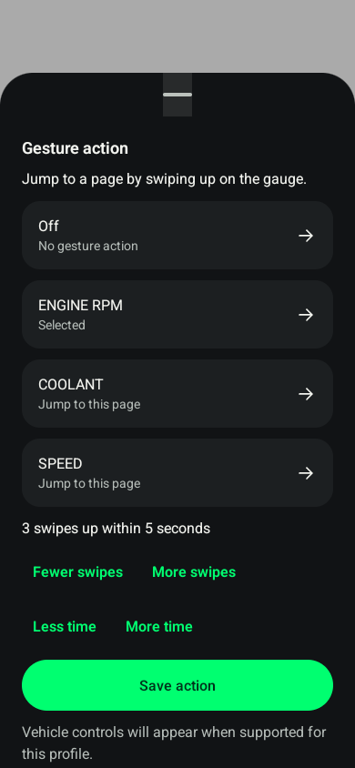

# Profile action fixture evidence

> Historical evidence. Versions, measurements and unfinished steps below describe that session.
> Current support is in [current state](../current-state.md); remaining work is in
> [the backlog](../backlog.md). These notes are not standing implementation instructions.

## Software verification, 2026-10-07

- 89 Android unit tests passed, including profile migration, action projection,
  exact readback, capability gating, invalid commands/parameters and child routing.
- Three isolated native Compose tests passed on the existing Television AVD with
  a forced 390 × 844 portrait viewport: save defaults/edits, older-firmware draft
  behavior and busy-state rejection. This is emulator evidence, not a Pixel test.
- 73 offline host tests passed; production config compiler/validator and pure
  gesture fixtures passed with AddressSanitizer/UndefinedBehaviorSanitizer.
- Debug APK/test APK, Android lint, ESP-IDF 5.4.1 build and contract/link checks passed.
- Emulator wake/display overrides were restored and the emulator was stopped.
  No physical device installation, BLE session or vehicle command occurred.

Native example of the action sheet with simulated profile data:

Physical gauge gesture recognition, touch/pairing regression, orientation, automatic
page cycling and restart persistence still need owner observations after an explicitly
qualified App/Wi-Fi candidate installation. Idle/ABS procedures still lack matching
controller identity, complete sequences, response semantics and restoration evidence.

The four Car goldens (compact/expanded, light/dark) were refreshed for the Actions
row and passed strict comparison on the API-36 emulator. GoldenScreenshotTest now
supports `fixtureName=car` for focused maintenance and waits up to five seconds for
foreground accessibility state before capture, avoiding a startup-focus race.
An unchanged Settings control comparison passed expanded references but differed
by 270/271 pixels around arrow glyphs in the compact references. Those original
Settings references and the existing tolerance were retained. This is a renderer
comparison limit, not a claim that the full Pixel golden suite passed; repeat that
suite on the Pixel before physical UI qualification.

## Shared command implementation, 2026-10-19

Offline source checks on the shared idle/ABS/TCS command path:

- Host suite: 111 tests and 7 review-server tests passed, plus native sanitizer
  fixtures. Shared controller replay covers independent slots, route/session replies,
  storage failure, cancellation, expiry/wrap, stale scopes/tickets/proofs, reboot
  uncertainty, negative/pending/wrong-controller/duplicate ABS replies and maintenance
  gate exclusion. These replay results do not qualify controller timing.
- Android: 220 JVM tests, debug APK build, instrumentation compilation and lint
  passed. All 39 allowlisted managed API-35 emulator tests passed, including the
  new command confirmation, direct Stop, unavailable/restart-required states and
  existing shortcut editing. The physical Pixel was not used or changed.
- ESP-IDF 5.4.1 image build and production LVGL/config binding fixtures passed.
  Menu states passed the circular glyph check. Linked image internal static use is
  164,162 bytes against the existing 196,608-byte limit; the 1,140-byte command owner
  and 513-byte response scratch link into external BSS. No new RTOS task was added.
  These are linked-image measurements, not live heap or stack qualification.
- Contract/document/website checks, formatter checks and diff whitespace checks
  passed. No release, installation, Bluetooth session or vehicle command occurred.

Both runtime qualification masks remain zero. The next parked steps are maintained
in [the shared-owner design](../architecture/vehicle-actions.md#next-parked-jeep-increment),
not inferred from fixture success. Fourth-button Line Lock is excluded.
